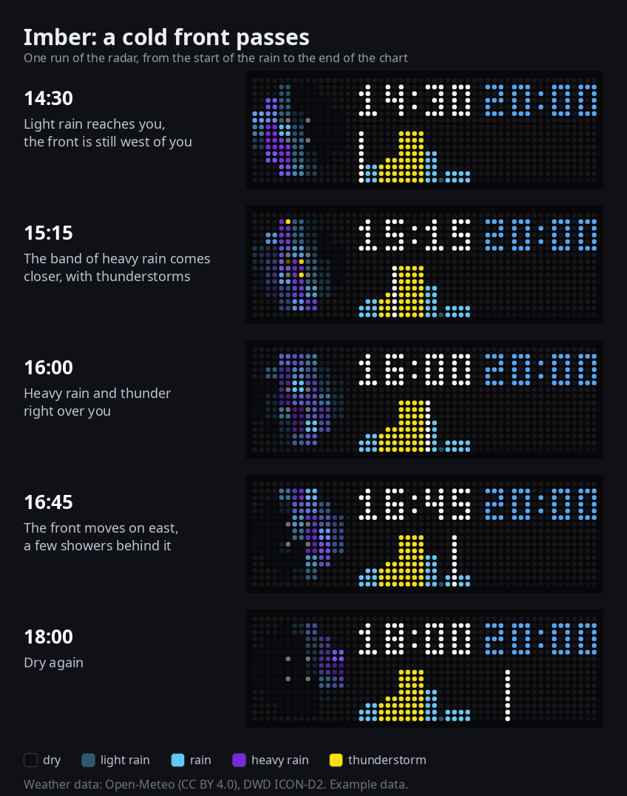

# Imber

**Should I take rain gear today?** Imber answers this at a glance on your AWTRIX clock: where the
rain is around you, when it starts at your place, and how the rest of your day looks. It is not a
weather report but a decision aid for the commute and the day.

*Imber* is Latin for "downpour".


[](https://ko-fi.com/exradice)

## How to read it

```
┌──────────────┬─────────────────────────────────────┐
│  rain radar  │  7:15 ───────────────────── 20:00   │  radar time (from the start of the rain), end
│ (animated,   │           │                         │
│  14 × 14 px) │  ▂▃▅▇▆▄▃▂▁│  ▁▂▂▁                   │  rain at your place, white line = radar time
└──────────────┴─────────────────────────────────────┘
```

- **Left: the rain radar.** A round map of the area around you, 20 km in every direction by
  default. You are in the middle, between the four grey dots. It plays the forecast hour by hour,
  from the start time to the end of the chart, so you see the rain move across your area and
  reach you (or pass by). Black is dry, the brighter the blue, the more rain per hour; heavy rain
  turns dark purple. A yellow dot marks thunderstorm potential; the brighter, the stronger. By
  default one run fills the app time of your rotation (*App duration* in the clock's settings),
  the last second standing still.
- **Top right: the time window.** On the left, in white, the time the radar is showing, to the
  quarter hour. Each run starts at the time the rain starts at your place (if it is already
  raining, now), so that is the first time you read. On the right the time the chart ends.
- **Bottom right: the chart.** One pixel column per slice of time between these two times. The
  height is the rain at your place; a yellow column means thunderstorm potential nearby. A
  **white line** runs along with the radar and shows which moment the radar is showing.



Imber **only joins the rotation when rain is expected** before the end of your day (20:00 by
default). On dry days you never see it.

## Requirements

- **An AWTRIX NG clock with a 52×16 display** (Ulanzi TC002).
- **Internet access** for the clock, to reach `api.open-meteo.com` over HTTPS.
- **A location in Germany or a neighbouring country.** Imber uses the ICON-D2 model of the German
  Weather Service, which covers Germany and the regions around it. Elsewhere the app shows no
  data.

No Home Assistant, no account and no API key needed.

## Setup

1. **Install the script.** Get *Imber* from the AWTRIX Hub, or create a script named `Imber` in
   the clock's web interface (*Scripts* tab) and paste [`imber.be`](imber.be).
2. **Enter your location.** *Apps* tab → gear icon of Imber → **Latitude** and **Longitude** in
   decimal degrees, for example `52.5200` and `13.4050`. A map app shows them when you tap and
   hold a place. The default is the centre of Germany.
3. **Optional:** adjust the map radius, the rain threshold, the end of your day and the animation
   length.

The first forecast arrives within a minute. If rain is coming today, Imber joins the rotation.

## Settings

In the clock's web interface, *Apps* tab, gear icon of Imber:

| Group | Setting | Default | What it does |
|---|---|---|---|
| Location | Latitude, Longitude | centre of Germany | Your place, the centre of the map |
| Location | Map radius | 20 km | How far the round map reaches; one cell is a third of it |
| Forecast | Rain from | 0.2 mm/h | Less counts as dry; raise it if light drizzle should not count |
| Forecast | End of day | 20 h | Radar and chart end here, but always cover at least 3 hours. Rain after this time does not bring Imber into the rotation |
| Forecast | Update every | 15 min | How often the forecast is fetched; ICON-D2 is updated every hour |
| Display | Animation length | 0 (automatic) | One run of the radar. 0: one run per app time of the rotation; shown outside the rotation (e.g. with *Show*) a run takes 10 s. Any other value: one run takes that long and Imber stays on screen for one run plus a second |
| Display | Heavy rain at | 4 mm/h | Rain rate that gets the full heavy rain colour and fills a bar to the top; from about a third of it the blue turns towards purple |
| Display | Storm full colour at | 10 J/kg | Lightning potential (LPI) that gets the brightest yellow |
| Display | Rain colour, Text colour | blue | Colours of the map, chart and times |
| Display | Heavy rain colour | dark purple | Heavy rain turns from the rain colour into this colour |
| Integration | Show only when (MQTT topic) | *(empty)* | See below |
| Integration | Indicator topic (MQTT) | *(empty)* | See below |
| Integration | Indicator colour | blue | Colour of that indicator |

## Optional: MQTT integration

Both settings are optional; leave them empty and Imber works on its own.

- **Show only when (MQTT topic):** Imber only joins the rotation while this topic says `on`
  (also `true` or `1`). Example: let Home Assistant publish `on` during your morning routine, so
  the forecast is on the clock while you get ready, and gone afterwards.
- **Indicator topic (MQTT):** lights one of the clock's indicators while rain is expected today,
  for example `<prefix>/cmd/indicators/3`.

**Use topics under your clock's prefix**, for example `kitchen/data/morning` and
`kitchen/cmd/indicators/3` for a clock with the prefix `kitchen` (field *Topic prefix* in the
clock's MQTT settings). If your broker only lets the clock read and write its own topics, other
topics silently do nothing.

## Good to know

- **Data:** [Open-Meteo](https://open-meteo.com), model ICON-D2 of the German Weather Service
  (DWD), about 2 km resolution, updated every hour.
- **Two requests per update:** hourly values for the map (one request for all 37 points) and
  15-minute values for your place. With the default interval of 15 minutes this is about 3,700
  location calls a day, within Open-Meteo's free limit of 10,000 for non-commercial use. Shorter
  intervals can exceed it.
- **Thunderstorms** are shown by the lightning potential index (LPI) of the model. It tells how
  likely and how strong lightning is, but it is not a probability.
- **On the days the clocks change** the end of the day can be one hour off.

## Troubleshooting

- **Imber never shows up:** that is normal on dry days. To see it anyway, start it from the web
  interface (*Apps* tab). `no data` means no forecast has arrived yet.
- **`no data` stays:** look at the clock's log. `Imber: map fetch failed, status …` or
  `15-minute fetch failed` point to a network problem or a location outside the ICON-D2 area.
- **It shows up although you set a gate topic:** check that the topic really says `off` (or
  anything other than `on`, `true`, `1`) and that the clock may read it.

## Privacy

The script sends your **latitude and longitude** (and the 37 map points around it) to
api.open-meteo.com with every update. Nothing else leaves your network.

## Credits

- Weather data by [Open-Meteo.com](https://open-meteo.com), licensed under
  [CC BY 4.0](https://creativecommons.org/licenses/by/4.0/), based on the ICON-D2 model of the
  [Deutscher Wetterdienst](https://www.dwd.de).
- Open-Meteo is free for non-commercial use. If you use it a lot or commercially, consider their
  [API plans](https://open-meteo.com/en/pricing), which keep the service running.
- AWTRIX is a name of its owner. Imber is an independent project and not affiliated with AWTRIX,
  Open-Meteo or the DWD.

## Support

Imber is free and stays free. If it saved you from getting wet and you want to say thanks, you
can [buy me a coffee on Ko-fi](https://ko-fi.com/exradice). Bug reports and ideas are welcome as
GitHub issues.

## License

[MIT](LICENSE) © 2026 exradice

---

<p align="center">Made with ❤️ in the EU 🇪🇺</p>
